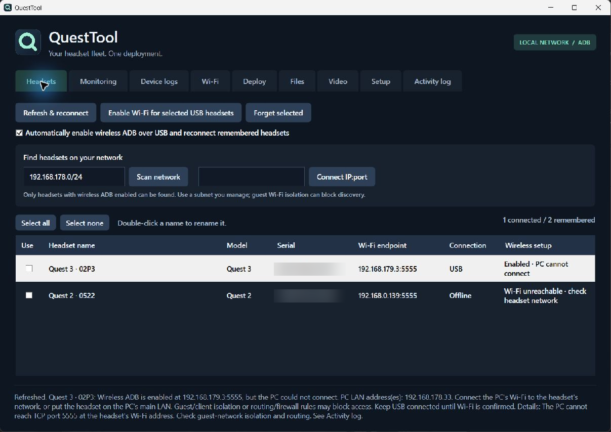
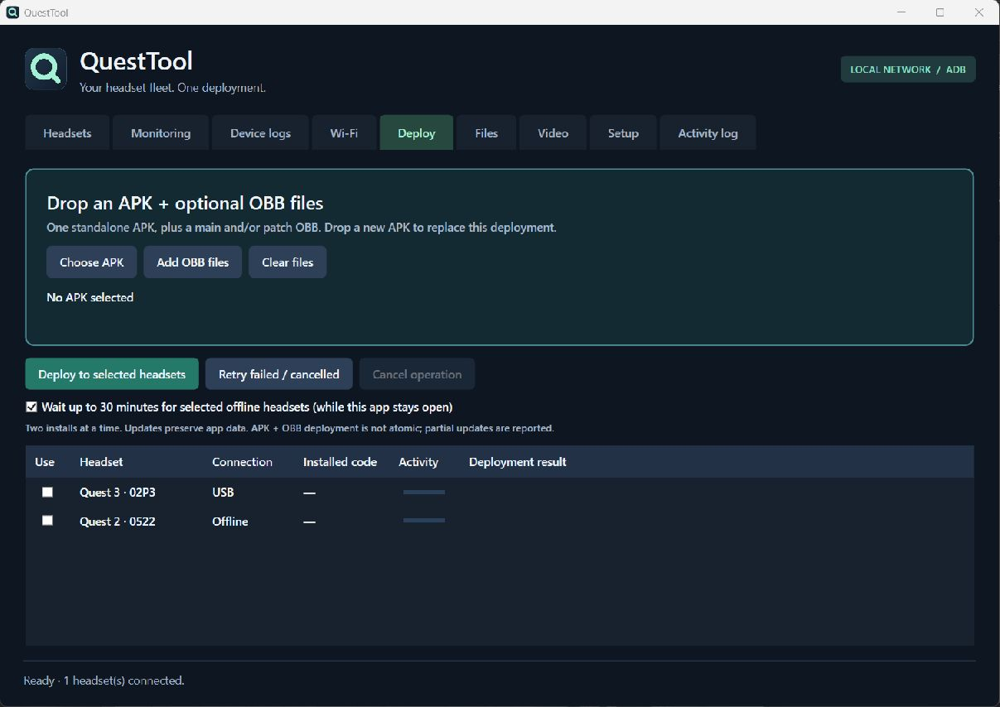
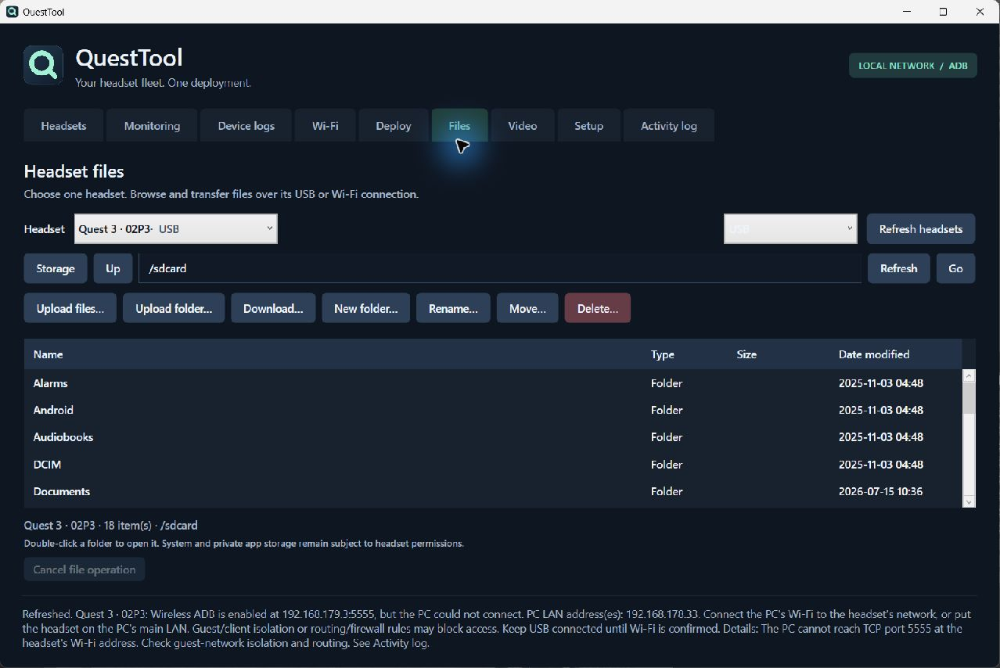
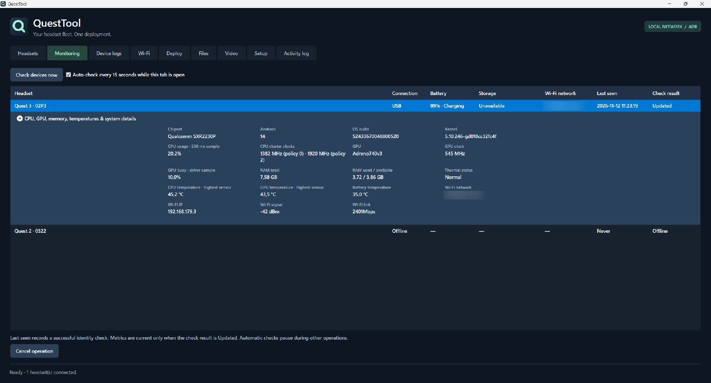
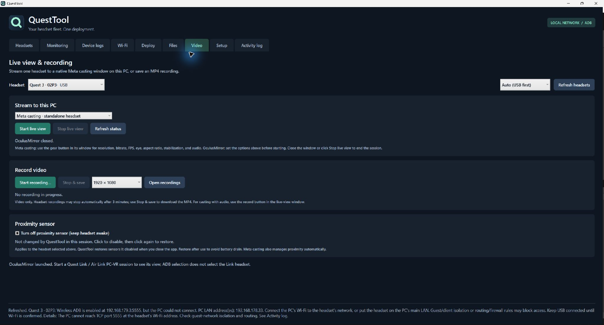

# QuestTool

A Windows app for managing Meta Quest headsets over USB or Wi-Fi. Install an APK on several headsets, transfer files, check device status, read logs, and open a live view.

**[Download for Windows (x64)](https://github.com/Timohjh/QuestTool/releases/download/preview-2026-11-12/QuestTool-windows.zip)** · [Release notes](https://github.com/Timohjh/QuestTool/releases/tag/preview-2026-11-12)



## Download and run

1. Download [QuestTool-windows.zip](https://github.com/Timohjh/QuestTool/releases/download/preview-2026-11-12/QuestTool-windows.zip).
2. Install the **.NET 10 Windows Desktop Runtime (x64)** from [Microsoft](https://dotnet.microsoft.com/download/dotnet/10.0). The runtime is enough; you don't need the SDK to run the app.
3. Extract the ZIP into a folder and open **QuestTool.exe**. Keep the files in that folder together.
4. Install [Android SDK Platform-Tools](https://developer.android.com/tools/releases/platform-tools). If QuestTool doesn't find ADB automatically, open **Setup** and select `adb.exe`. Keep ADB's DLLs beside it.

The Windows download is unsigned. ADB and Meta's tools are separate downloads and aren't included in the ZIP.

## Connect a headset

1. Enable Developer Mode and follow [Meta's device setup guide](https://developers.meta.com/vr/documentation/native/android/mobile-device-setup).
2. Connect the headset with a USB data cable. Put it on and accept the USB debugging prompt.
3. Open **Headsets** and click **Refresh & reconnect**.
4. Tick the headsets you want to use. You can double-click a headset's name to rename it.

QuestTool remembers headsets between sessions and checks their serial numbers before device operations.

### Connect over Wi-Fi

Keep USB connected for the initial setup. Connect the PC and headset to a network where they can reach each other, then click **Enable Wi-Fi for selected USB headsets**. Unplug USB after the row shows **Connected · verified**.

Automatic wireless ADB setup and reconnection are enabled by default. Turn off **Automatically enable wireless ADB** in Headsets if you prefer to enable it manually.

Use **Refresh** in the app header to update the current tab. QuestTool also refreshes on startup, when opening a tab, and when returning after at least 60 seconds away. Refreshes keep the controls available and retain the displayed data until new results arrive. Starting a device operation cancels an in-progress refresh; refresh requests during that operation wait until it finishes. Wireless reconnection runs with these refreshes instead of on a repeating timer.

Use **Connect IP:port** for a known address or **Scan network** to find headsets that already have wireless ADB enabled. Scanning supports IPv4 subnets from /22 to /32 on port 5555. It can't authorize a new headset.

If you see **Enabled · PC cannot connect**, keep USB connected. Guest Wi-Fi isolation, separate networks, routing, or firewall rules may be blocking the connection. Wireless ADB may need to be enabled again after a headset reboot. See [Meta's ADB guide](https://developers.meta.com/vr/documentation/native/android/ts-adb).

## Manage installed apps

Open **Apps** and choose a headset to list its installed apps. Search by package name, or enable **Include system apps** to show built-in packages too. Click an app row to expand its version name/code, install and update dates, APK path, and data folder.

The expanded row groups **Launch**, **Restart**, and **Close app** under app controls. Close app force-stops the package. Packages without a launchable activity report an error when launched. App names in the list are taken from their package identifiers.

Tools include **App settings**, **Show logs**, **Export APK**, **Copy package name**, and **Clear cache**. Show logs opens Device logs filtered to the app's currently running main and child processes; use **Show all apps** to remove that scope. APK export creates a new local folder containing the base APK and any split APKs, without app data or OBB files. Cache clearing preserves saved app data and reports unsupported firmware instead of resetting the app.

Expand **Manage data & uninstall** for **Clear app data** and **Uninstall**. Both apply to the current headset user and require confirmation showing the package and headset. Clearing app data deletes saved settings, sign-ins, and progress. Uninstall removes the app and its data for that user.

## Install an app



1. Select the target headsets in **Headsets**.
2. Open **Deploy** and choose or drop a standalone APK.
3. Add a main and/or patch OBB if the app needs them.
4. Check the displayed package and version, then click **Deploy to selected headsets**.

You can select multiple headsets for one deployment. QuestTool installs on up to **two headsets at a time**; the remaining selected headsets wait in the queue. Offline devices can wait for up to 30 minutes while QuestTool stays open. Use **Retry failed / cancelled** to retry selected targets that didn't finish.

Updates preserve app data and reject older version codes. The APK must use the same package name and signing key as the installed app. Split APKs and AABs aren't supported.

OBB filenames must follow `main.<version>.<package>.obb` or `patch.<version>.<package>.obb`. QuestTool checks the package, file size, and SHA-256 before replacing an OBB. Older OBB versions can be reused with a newer APK.

An APK and its OBB files aren't installed as one transaction. If an OBB fails after the APK installs, retry before opening the app. Cancelling doesn't undo completed changes.

## Files



Open **Files**, choose a headset, and browse shared storage under `/sdcard`. Choose **Auto (USB first)**, **USB**, or **Wi-Fi** for the connection.

You can upload or download files and folders, create folders, rename, move, and delete items. Replacements and deletions ask for confirmation. Existing folders aren't merged or overwritten; choose a new destination. Symbolic links are shown but can't be opened or transferred.

Transfers can be cancelled. If a download stalls, try USB or reconnect Wi-Fi. Headset storage permissions still apply to restricted folders.

## Monitoring and logs



**Monitoring** shows battery, charging, storage, Wi-Fi, and connection status. Select a headset to expand its CPU, GPU, memory, temperature, and system details. Some firmware versions restrict individual metrics; these show as unavailable. Optional automatic checks run every 15 seconds while the tab is open and the app has focus, and pause during other operations.

**Device logs** captures up to 1,000 recent Android logcat lines from one headset. Choose a minimum priority, filter by text, and save the displayed output. Optional automatic refresh runs every five seconds while the tab is open and the app has focus.

**Activity log** records QuestTool's own operations separately from the headset logs.

## Change Wi-Fi

Open **Wi-Fi**, choose a headset, and click **Scan available networks**. Select a network or type a hidden SSID, choose its security type, and enter the password.

Changes apply to the headsets ticked in **Headsets**. Each selected headset must stay connected by USB until the change is confirmed. WPA2 Personal, WPA3 Personal, and open networks are supported. Enterprise networks and captive portals need setup inside the headset; use **Open headset Wi-Fi settings**.

QuestTool doesn't save Wi-Fi passwords or include them in its activity/error messages. After changing networks, wait for wireless ADB to reconnect before unplugging USB.

## Live view and recording



Open **Video** and choose a headset.

- **Meta casting** shows the standalone headset view. Install [Meta VR CLI](https://github.com/meta-quest/agentic-tools), select `metavr.exe` in **Setup** if needed, and click **Check tools**. Use **Install / repair casting client** if the separate casting client is missing. The casting window has its own resolution, bitrate, FPS, eye, and audio settings.
- **OculusMirror** shows an active Quest Link / Air Link PC VR session. It requires Meta Quest Link PC software. It doesn't mirror an app running directly on the standalone headset. Choose the mirror settings before starting it.
- **Start recording…** records a video-only MP4. **Stop & save** stops capture and downloads it to the filename you chose. A headset recording may stop after three minutes; still click **Stop & save** to retrieve it. For recording with audio, use the recording control in Meta's casting window.
- **Turn off proximity sensor** keeps a headset awake when removed. Click again to restore normal wear detection.

Keep QuestTool open during capture. On normal exit it saves pending recordings, closes the live view it started, and restores sensors it disabled. If cleanup fails, reconnect the headset and retry before closing. A forced exit can't perform that cleanup.

## Settings and privacy

Settings are stored in `%LOCALAPPDATA%/QuestTool/settings.json`, including remembered headset names, serial numbers, network addresses, tool paths, and the recording folder.

QuestTool has no account, hosted backend, or application telemetry. It uses tools installed on your PC; those tools have their own terms and network behavior. Logs and recordings may contain private information, so review them before sharing.

Use devices, networks, and APKs you're authorized to manage. QuestTool doesn't update Horizon OS or uninstall apps as part of deployment.

## Build from source

Install the .NET 10 SDK, then run:

```powershell
dotnet run --project QuestTool.csproj
```

You can also double-click `Start-QuestTool.cmd`.

Run the automated checks with:

```powershell
dotnet run --project Tests/QuestTool.Tests.csproj
dotnet run --project Tests/RefreshChecks/QuestTool.RefreshChecks.csproj
```

These checks use simulated device connections. They don't replace testing with your APKs and headsets.

## License

[MIT](LICENSE). QuestTool is an independent project and isn't affiliated with or endorsed by Meta.
